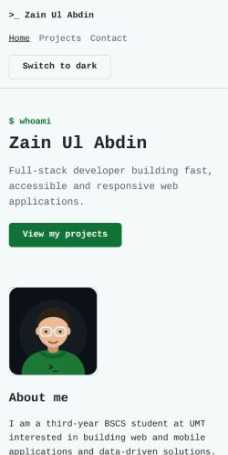

# Zain ul abidin – Developer Portfolio
Responsive 3-page portfolio built with semantic HTML5, hand-written CSS3 and vanilla JavaScript.
## Features
- Semantic, accessible HTML (landmarks, labels, alt text)
- Mobile-first layout: Flexbox navbar, CSS Grid cards (1 / 2 / 3 columns)
- Light and dark theme via CSS custom properties, OS preference and a saved manual toggle
- Projects rendered from a JavaScript array, with combined search and technology filter
- Contact form with per-field JavaScript validation

## Run locally
Open `index.html` in a browser. No build step.

## Deployment
- Repository: https://github.com/zainshafique77-hash/Portfolio
- GitHub Pages: https://zainshafique77-hash.github.io/Portfolio/

## Lighthouse (mobile)
Homepage audit: Performance 100, Accessibility 100, Best Practices 100, SEO 100.
Tested with Lighthouse 13.6.0 on an emulated Moto G Power with slow 4G.

## Bonus
Project cards use a subtle hover transition only when `prefers-reduced-motion: no-preference` is set.

## Validation and assignment evidence
The live GitHub Pages versions of the home, projects, and contact pages each returned zero messages from the Nu HTML Checker (v26.11.20). All three pages were also checked at a 360 px viewport with no horizontal overflow.

[Download the two-page Assignment 1 evidence PDF](Portfolio-Assignment-1-Evidence.pdf).
